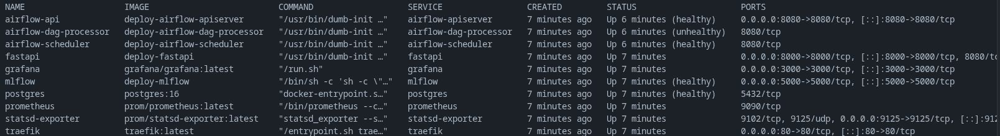
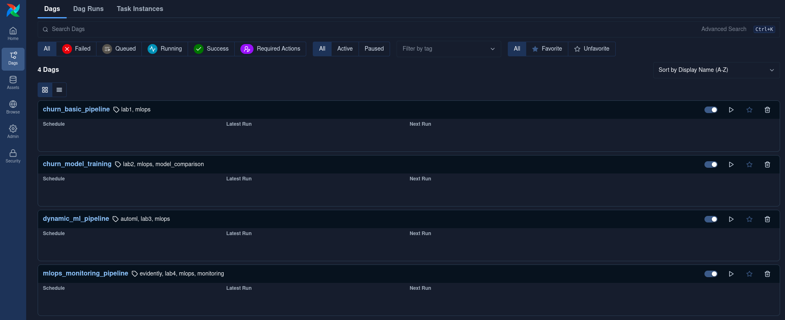
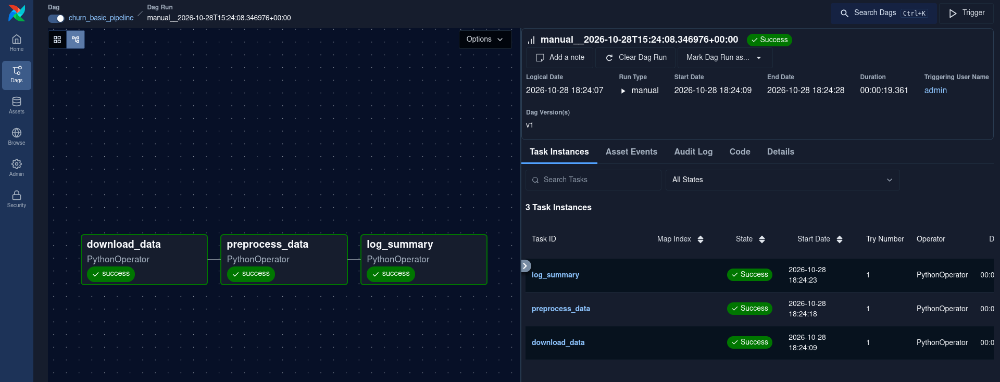
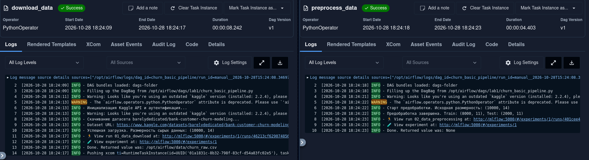
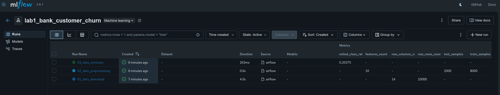
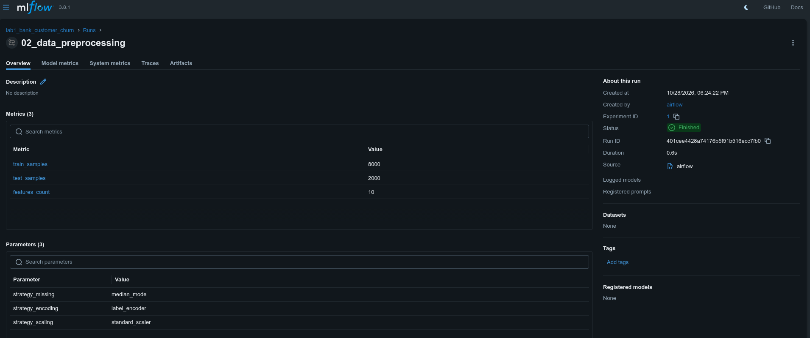
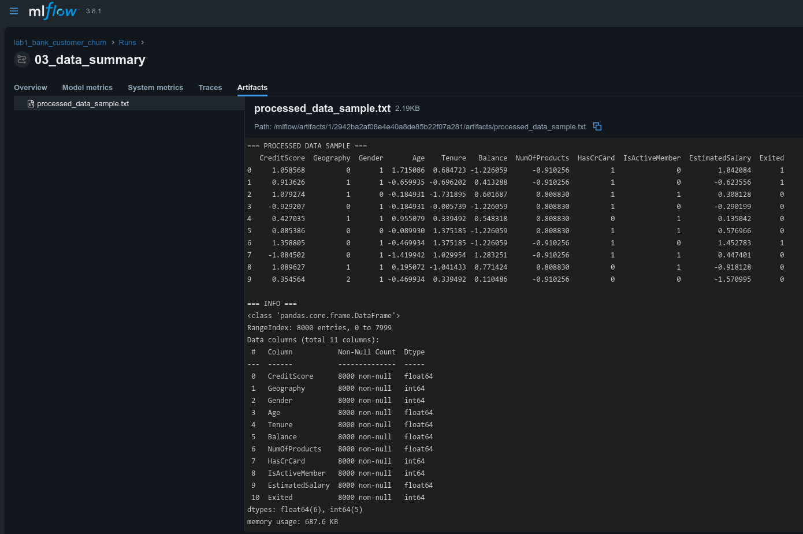

# Отчет по лабораторной работе №1
## Дисциплина: «Автоматизация машинного обучения»
### Тема: Базовый пайплайн для одного датасета (Оркестрация в Airflow и трекинг в MLflow)

**Вариант:** №6 — Прогнозирование оттока клиентов банка (`Bank Customer Churn`)  
**Тип задачи:** Бинарная классификация

---

## 1. Цель работы
Освоить базовые принципы оркестрации пайплайнов данных с помощью Apache Airflow, настроить безопасное подключение к внешнему источнику данных (Kaggle API), реализовать модульную предобработку табличных данных и автоматизировать логирование параметров, метрик и артефактов в MLflow Tracking.

---

## 2. Описание выбранного датасета
* **Источник:** Kaggle (`barelydedicated/bank-customer-churn-modeling`).
* **Объем выборки:** 10 000 строк, 14 колонок.
* **Целевая переменная:** `Exited` (`1` — клиент покинул банк, `0` — клиент остался).
* **Признаковое пространство:**
  * Служебные поля (удаляются при очистке): `RowNumber`, `CustomerId`, `Surname`.
  * Категориальные признаки: `Geography` (страна), `Gender` (пол).
  * Числовые признаки: `CreditScore`, `Age`, `Tenure`, `Balance`, `NumOfProducts`, `HasCrCard`, `IsActiveMember`, `EstimatedSalary`.

---

## 3. Архитектура и реализация пайплайна
Инфраструктура развернута в Docker Compose и включает контейнеры Apache Airflow (`apiserver`, `scheduler`, `dag-processor`), PostgreSQL 16 и MLflow Server, объединенные общим томом данных `/opt/airflow/data`.

Граф `churn_basic_pipeline` состоит из 3 последовательных задач (`PythonOperator`):
1. **`download_data` (`lab1/scripts/data_loader.py`):** Аутентификация в Kaggle API, скачивание и распаковка архива, сохранение сырого набора `churn_raw.csv`, запись метрик `raw_rows_count` и `raw_columns_count` в MLflow.
2. **`preprocess_data` (`lab1/scripts/data_preprocessor.py`):** Удаление неинформативных идентификаторов, заполнение пропусков медианой и модой, кодирование категорий через `LabelEncoder`, стратифицированное разделение на `train/test` (80/20) и масштабирование числовых полей через `StandardScaler`.
3. **`log_summary`:** Вычисление доли целевого класса (`exited_class_ratio`) и сохранение диагностического сэмпла данных `processed_data_sample.txt` в артефакты MLflow.

---

## 4. Результаты выполнения и иллюстрации

### 4.1. Инфраструктура контейнеров Docker
Все микросервисы инфраструктуры успешно запущены и прошли проверки состояния (`healthy`).

  
*Рисунок 1 — Статус запущенных контейнеров инфраструктуры в Docker.*

### 4.2. Регистрация DAG в веб-интерфейсе Apache Airflow
Даг `churn_basic_pipeline` успешно обнаружен процессором дагов Airflow, активирован и готов к запуску.

  
*Рисунок 2 — Отображение DAG `churn_basic_pipeline` на главной панели Airflow.*

### 4.3. Граф выполнения задач (Graph View)
Все три этапа пайплайна (`download_data` ➔ `preprocess_data` ➔ `log_summary`) отработали последовательно и завершились со статусом `Success`.

  
*Рисунок 3 — Граф успешного выполнения пайплайна в Airflow.*

### 4.4. Логи выполнения задачи загрузки и предобработки
В логах задачи подтверждается успешная аутентификация в Kaggle API, скачивание 10 000 записей и разбиение на выборки Train (8000 строк) и Test (2000 строк).

  
*Рисунок 4 — Журнал выполнения задач скачивания и очистки данных в Airflow.*

### 4.5. Эксперимент и запуски в MLflow Tracking
В веб-интерфейсе MLflow автоматически создан эксперимент `lab1_bank_customer_churn`, содержащий три запуска для каждого этапа конвейера.

  
*Рисунок 5 — Список зафиксированных запусков в эксперименте `lab1_bank_customer_churn`.*

### 4.6. Залогированные параметры и метрики предобработки
В карточке запуска `02_data_preprocessing` сохранены стратегии обработки (`label_encoder`, `median_mode`, `standard_scaler`) и численные метрики выборок (`train_samples: 8000`, `test_samples: 2000`, `features_count: 10`).

  
*Рисунок 6 — Детализация залогированных параметров и метрик в MLflow.*

### 4.7. Просмотр сгенерированного артефакта данных
В запуске `03_data_summary` сохранен файл `processed_data_sample.txt`, содержащий первые 10 строк отмасштабированной выборки и сводку по типам колонок (`DataFrame.info()`).

  
*Рисунок 7 — Предпросмотр текстового артефакта `processed_data_sample.txt` в MLflow UI.*

---

## 5. Вывод
В ходе выполнения работы развернута контейнерная MLOps-инфраструктура на базе Apache Airflow и MLflow. Реализован отказоустойчивый ETL-пайплайн автоматической выгрузки банковского датасета с Kaggle, проведена очистка и стандартизация признаков, настроено сохранение параметров, метрик и артефактов предобработки.
