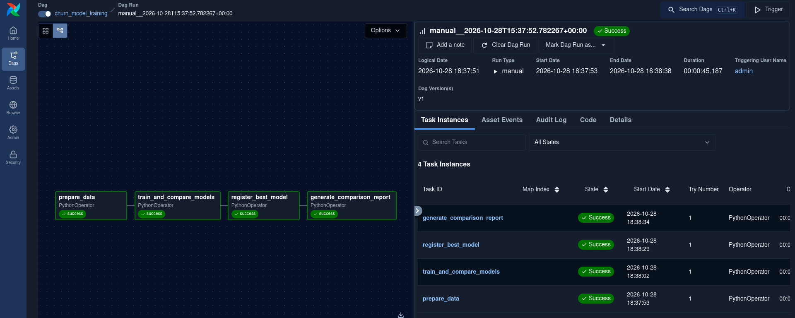
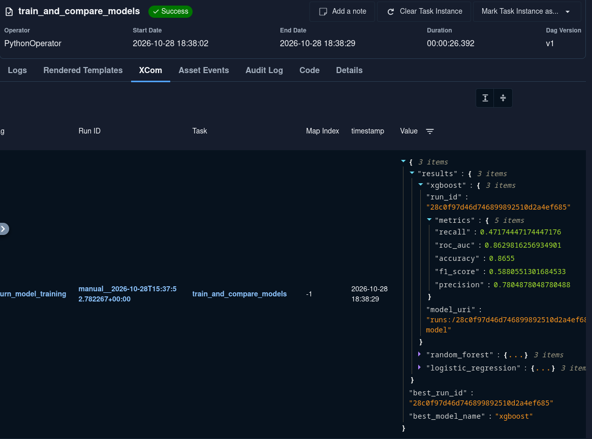
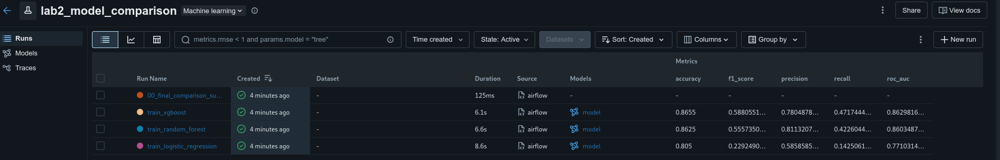
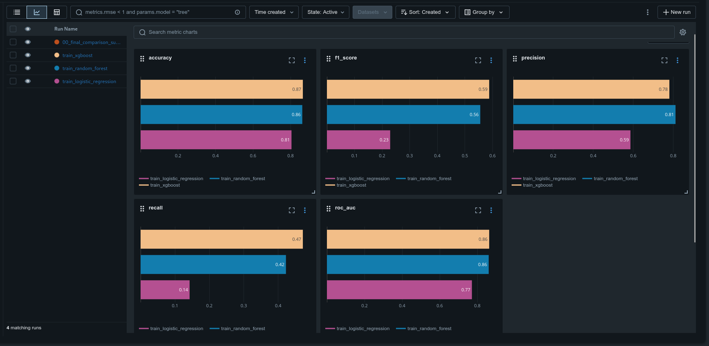
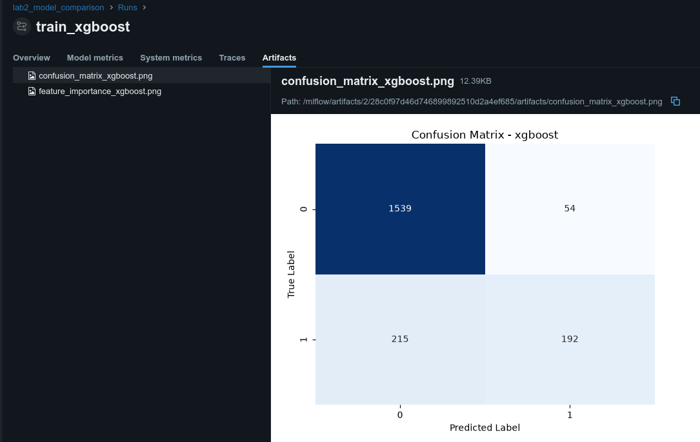
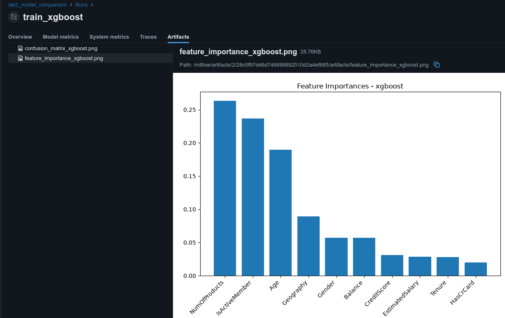
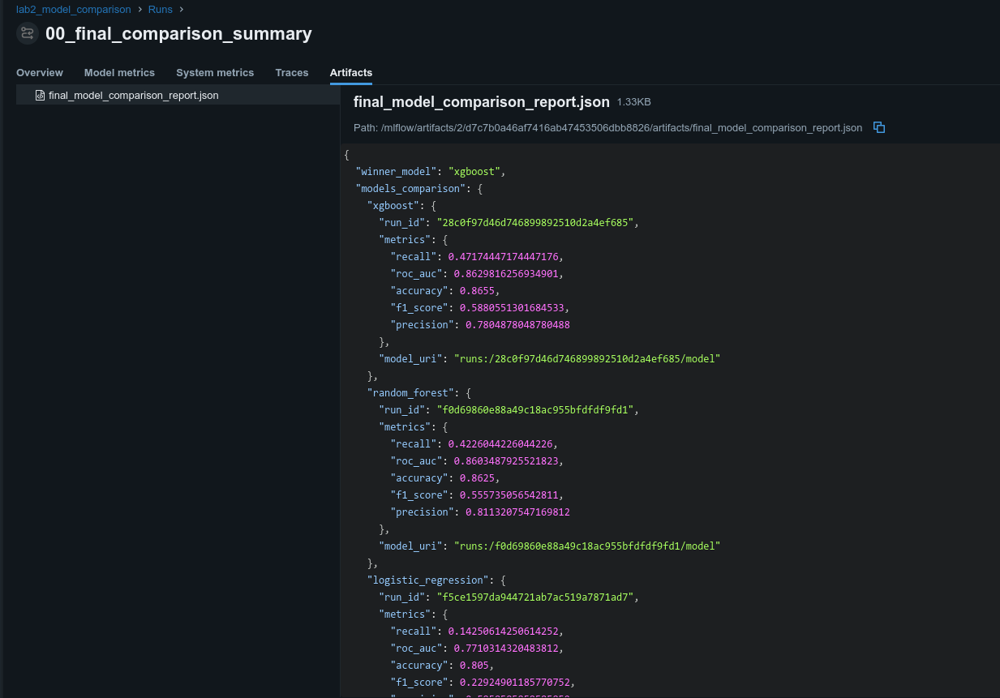
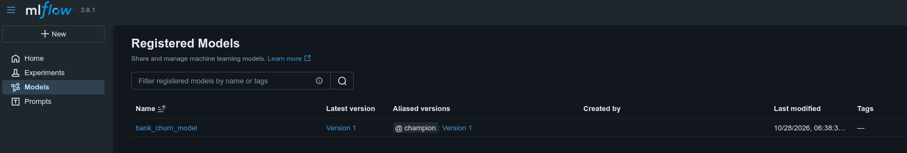

# Отчет по лабораторной работе №2
## Дисциплина: «Автоматизация машинного обучения»
### Тема: Сравнительный анализ моделей машинного обучения и MLflow Model Registry

**Вариант:** №6 — Прогнозирование оттока клиентов банка (`Bank Customer Churn`)  
**Тип задачи:** Бинарная классификация

---

## 1. Цель работы
Освоить управление жизненным циклом моделей машинного обучения с помощью Apache Airflow и MLflow. Реализовать автоматизированное обучение нескольких алгоритмов классификации, расчёт метрик качества, генерацию графических артефактов (матриц ошибок и важности признаков), а также автоматический выбор лучшей модели и её регистрацию в MLflow Model Registry с присвоением алиаса `@champion`.

---

## 2. Исследуемые алгоритмы и метрики
В работе сравниваются три модели различной природы:
1. **Logistic Regression:** линейный классификатор (`max_iter=1000`).
2. **Random Forest Classifier:** ансамбль решающих деревьев на базе бэггинга (`n_estimators=100`, `max_depth=10`).
3. **XGBoost Classifier:** градиентный бустинг над решающими деревьями (`n_estimators=100`, `max_depth=5`, `learning_rate=0.1`).

Оценка проводится на отложенной тестовой выборке по метрикам: `Accuracy`, `Precision`, `Recall`, `F1-Score` (основная метрика выбора победителя) и `ROC-AUC`.

---

## 3. Архитектура пайплайна (`churn_model_training`)
1. **`prepare_data`:** Загрузка и предобработка датасета с сохранением выборок в общий том `/opt/airflow/data`.
2. **`train_and_compare_models`:** Обучение трех алгоритмов, логирование гиперпараметров, метрик, графиков и сериализованных моделей в MLflow, передача лучшего `run_id` через механизм Airflow XCom.
3. **`register_best_model`:** Регистрация лучшей модели в **MLflow Model Registry** под именем `bank_churn_model` и назначение ей продуктивного алиаса `@champion`.
4. **`generate_comparison_report`:** Генерация итогового JSON-отчета `final_model_comparison_report.json` со сводкой по всем моделям.

---

## 4. Результаты выполнения и иллюстрации

### 4.1. Граф выполнения пайплайна обучения в Airflow
Все четыре задачи дага `churn_model_training` успешно выполнены.

  
*Рисунок 1 — Успешное выполнение графа `churn_model_training` в Apache Airflow.*

### 4.2. Передача метаданных лучшей модели через Airflow XCom
На вкладке XCom задачи `train_and_compare_models` зафиксирован словарь с именем победившей модели (`xgboost`), её идентификатором запуска и метриками всех кандидатов.

  
*Рисунок 2 — Передача результатов обучения и выбора победителя через Airflow XCom.*

### 4.3. Сравнительная таблица запусков в MLflow Tracking
В эксперименте `lab2_model_comparison` отображаются запуски всех трех моделей и сводный отчет.

| Алгоритм | Accuracy | F1-Score | Precision | Recall | ROC-AUC |
| :--- | :---: | :---: | :---: | :---: | :---: |
| **XGBoost (Победитель)** | **0.8655** | **0.5880** | 0.7805 | **0.4717** | **0.8630** |
| **Random Forest** | 0.8625 | 0.5557 | **0.8113** | 0.4226 | 0.8603 |
| **Logistic Regression** | 0.8050 | 0.2292 | 0.5858 | 0.1425 | 0.7710 |

  
*Рисунок 3 — Таблица запусков и метрик качества моделей в MLflow.*

### 4.4. Диаграммы сравнения метрик (MLflow Chart View)
На вкладке визуализации графиков (`Chart View`) представлены столбчатые диаграммы по всем пяти метрикам качества для каждого алгоритма:
* По ключевой метрике **`f1_score`** лидирует `train_xgboost` (**0.59**), опережая `train_random_forest` (**0.56**) и значительно превосходя `train_logistic_regression` (**0.23**).
* По полноте (**`recall`**) бустинг также занимает первое место (**0.47** против **0.42** у случайного леса и **0.14** у логистической регрессии).
* Случайный лес показывает чуть более высокую точность (**`precision` = 0.81** против **0.78** у XGBoost), однако уступает по общему балансу $F_1$ и площади под кривой **`roc_auc`**.

  
*Рисунок 4 — Столбчатые диаграммы сопоставления метрик трех моделей в режиме MLflow Chart View.*

### 4.5. Артефакт: Матрица ошибок (Confusion Matrix)
Для каждой модели сгенерирована и прикреплена тепловая карта матрицы ошибок на тестовой выборке.

  
*Рисунок 5 — Матрица ошибок модели-победителя XGBoost в артефактах MLflow.*

### 4.6. Артефакт: Важность признаков (Feature Importance)
График важности признаков показывает, что наибольший вклад в прогнозирование ухода клиента вносят количество продуктов (`NumOfProducts`), возраст (`Age`) и активность клиента (`IsActiveMember`).

  
*Рисунок 6 — График важности признаков (Feature Importances) в MLflow.*

### 4.7. Итоговый JSON-отчет сравнения моделей
В запуске `00_final_comparison_summary` сохранен структурированный файл `final_model_comparison_report.json` с полными результатами эксперимента.

  
*Рисунок 7 — Просмотр сводного отчета `final_model_comparison_report.json` в MLflow.*

### 4.8. Регистрация лучшей модели в MLflow Model Registry
Модель `xgboost` автоматически зарегистрирована в реестре под именем `bank_churn_model` (Version 1) и отмечена алиасом `@champion`.

  
*Рисунок 8 — Зарегистрированная модель `bank_churn_model` с алиасом `@champion` в Model Registry.*

---

## 5. Вывод
В ходе лабораторной работы реализован конвейер многомодельного обучения и валидации. Проведено объективное сравнение алгоритмов по комплексу метрик, настроена автоматическая генерация визуализаций и внедрена регистрация лучшей модели в MLflow Model Registry.