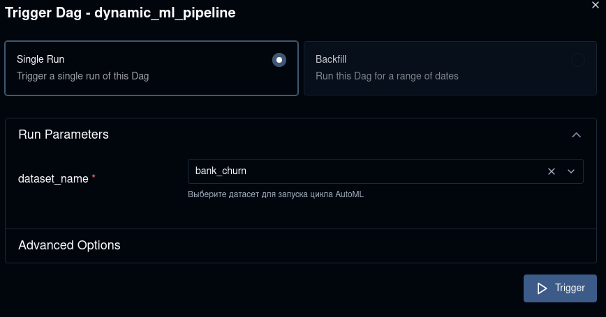
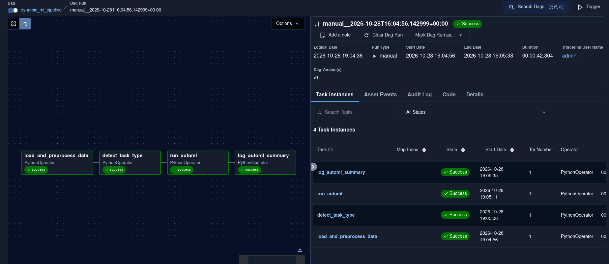
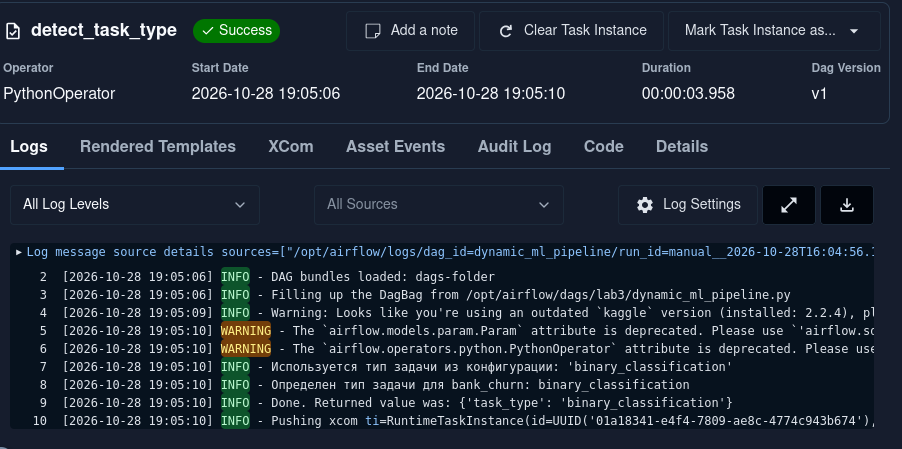
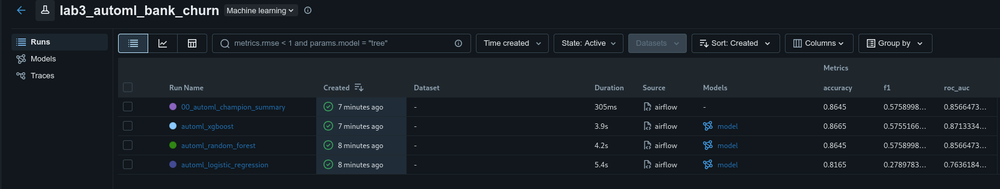
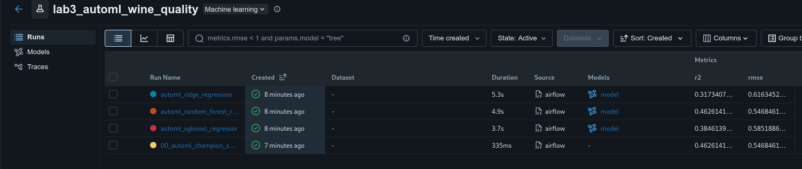
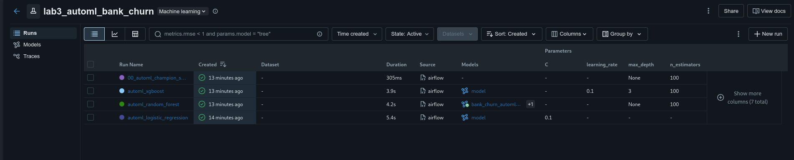
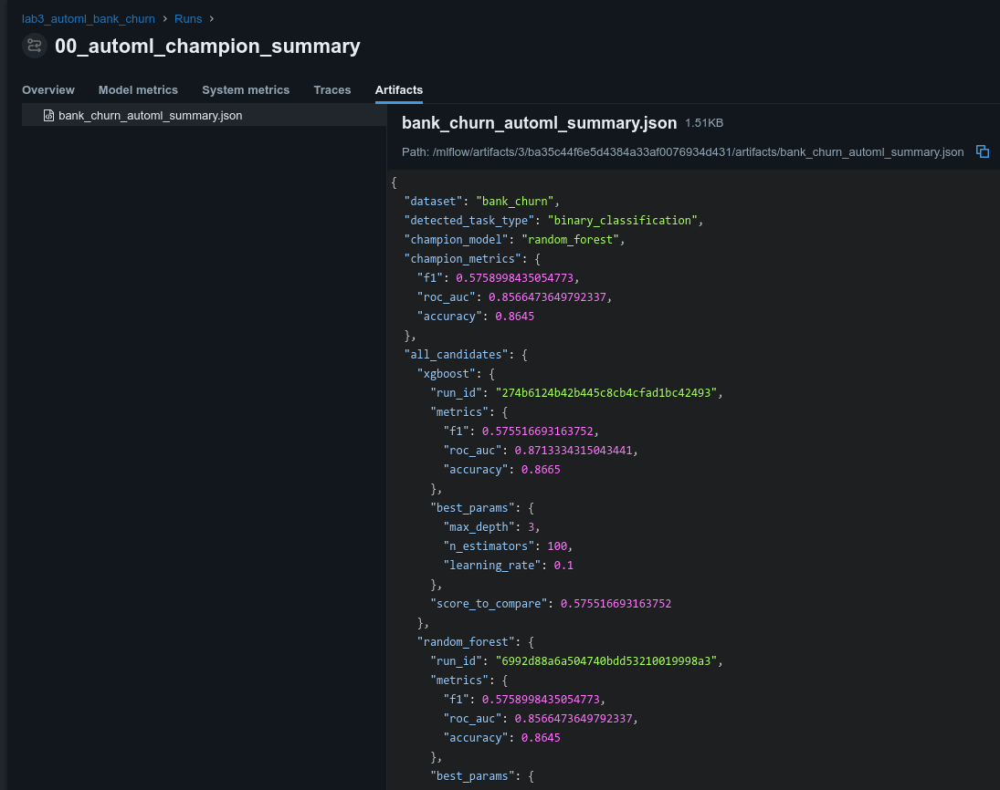
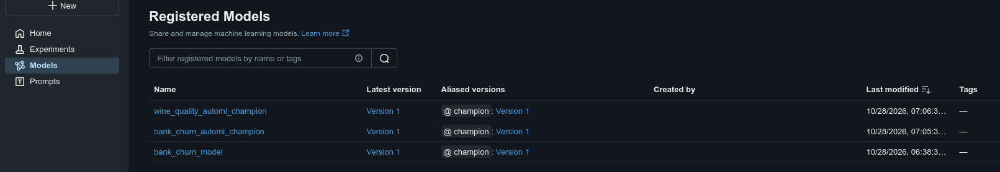

# Отчет по лабораторной работе №3
## Дисциплина: «Автоматизация машинного обучения»
### Тема: Динамический пайплайн для нескольких датасетов и AutoML

**Исследуемые датасеты:**  
1. `bank_churn` (Бинарная классификация оттока клиентов)  
2. `wine_quality` (Регрессия оценки качества вина)

---

## 1. Цель работы
Разработать универсальный динамический MLOps-пайплайн, способный адаптироваться под произвольные табличные датасеты на основе конфигурационного файла. Реализовать автоматическое распознавание типа ML-задачи по целевой переменной и внедрить модуль AutoML для автоматического подбора моделей и оптимизации их гиперпараметров.

---

## 2. Архитектура решения
* **Конфигурационный файл (`lab3/config/dataset_configs.json`):** Хранит метаданные датасетов (идентификатор на Kaggle, имя целевой колонки, тип задачи и целевую метрику).
* **Параметризация через Airflow UI (`Param`):** При запуске дага `dynamic_ml_pipeline` пользователь выбирает нужный датасет из выпадающего списка.
* **Детектор типа задачи (`TaskDetector`):** Анализирует тип данных и число уникальных значений целевой переменной, классифицируя задачу как `binary_classification`, `multiclass_classification` или `regression`.
* **Модуль AutoML (`DynamicAutoMLTrainer`):** Формирует пул релевантных алгоритмов (`LogisticRegression`/`RandomForestClassifier`/`XGBClassifier` для классификации; `Ridge`/`RandomForestRegressor`/`XGBRegressor` для регрессии) и запускает кросс-валидационный поиск гиперпараметров `RandomizedSearchCV`.

---

## 3. Результаты выполнения и иллюстрации

### 3.1. Интерфейс параметризированного запуска в Airflow UI
При нажатии кнопки Trigger DAG открывается форма выбора целевого датасета (`bank_churn` или `wine_quality`), сформированная динамически из `dataset_configs.json`.

  
*Рисунок 1 — Форма выбора датасета через Airflow Params перед запуском пайплайна.*

### 3.2. Успешное выполнение динамического графа задач
Граф `dynamic_ml_pipeline` (`load_and_preprocess_data` ➔ `detect_task_type` ➔ `run_automl` ➔ `log_automl_summary`) успешно отработал для обоих датасетов.

  
*Рисунок 2 — Граф выполнения `dynamic_ml_pipeline` в Apache Airflow.*

### 3.3. Журнал работы детектора задачи и универсальной очистки
В логах задачи `detect_task_type` видно автоматическое определение `binary_classification` для банковского датасета и `regression` для датасета качества вина.

  
*Рисунок 3 — Логи работы модуля `TaskDetector` при определении типа задачи.*

### 3.4. Эксперимент AutoML для задачи классификации (`bank_churn`)
В MLflow создан эксперимент `lab3_automl_bank_churn`, в котором зафиксированы результаты подбора гиперпараметров для классификаторов и сводка чемпиона.

  
*Рисунок 4 — Результаты работы AutoML для датасета `bank_churn` (метрики F1, Accuracy, ROC-AUC).*

### 3.5. Эксперимент AutoML для задачи регрессии (`wine_quality`)
При запуске того же пайплайна с параметром `wine_quality` в MLflow автоматически создан эксперимент `lab3_automl_wine_quality`, где обучены регрессионные модели и рассчитаны метрики `RMSE` и `R2`.

  
*Рисунок 5 — Результаты работы AutoML для датасета `wine_quality` (регрессионные метрики RMSE и R2).*

### 3.6. Сравнение подобранных гиперпараметров кандидатов в MLflow
В таблице эксперимента с включенными колонками `Parameters` отображаются оптимальные гиперпараметры, найденные в ходе `RandomizedSearchCV` для каждого семейства алгоритмов:
* **`automl_logistic_regression`:** коэффициент регуляризации `C = 0.1`.
* **`automl_xgboost`:** `learning_rate = 0.1`, `max_depth = 3`, `n_estimators = 100`.
* **`automl_random_forest` (Победитель AutoML):** снятие ограничения глубины `max_depth = None` при `n_estimators = 100` позволило случайному лесу достичь наивысшего качества ($F_1 = 0.5759$, $\text{Accuracy} = 0.8645$) и автоматически получить статус чемпиона `bank_churn_automl_champion`.

  
*Рисунок 6 — Сводная таблица подобранных гиперпараметров для всех кандидатов AutoML в MLflow.*

### 3.7. Сводный JSON-артефакт результатов AutoML
В артефактах запуска `00_automl_champion_summary` сохранен файл `*_automl_summary.json`, содержащий сравнение всех кандидатов и их лучших конфигураций.

  
*Рисунок 7 — Содержимое артефакта со сводкой оптимизации AutoML.*

### 3.8. Регистрация чемпионов для каждого датасета в Model Registry
В реестре моделей MLflow автоматически созданы независимые записи `bank_churn_automl_champion` и `wine_quality_automl_champion` с алиасами `@champion`.

  
*Рисунок 8 — Зарегистрированные модели-чемпионы для разных датасетов в MLflow Model Registry.*

---

## 4. Вывод
Разработан универсальный параметризированный MLOps-пайплайн. Благодаря динамической очистке данных, автоматическому определению типа задачи и встроенному поиску гиперпараметров один и тот же граф Airflow успешно решает как задачи классификации, так и задачи регрессии без модификации исходного кода.