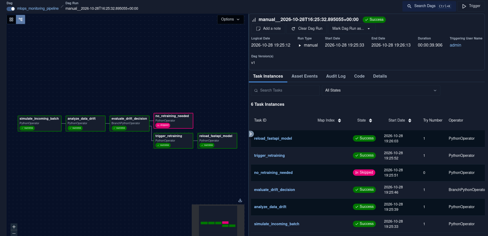
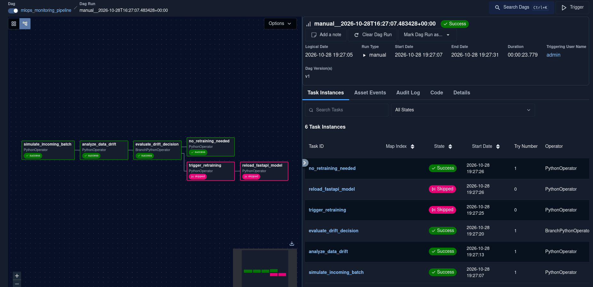
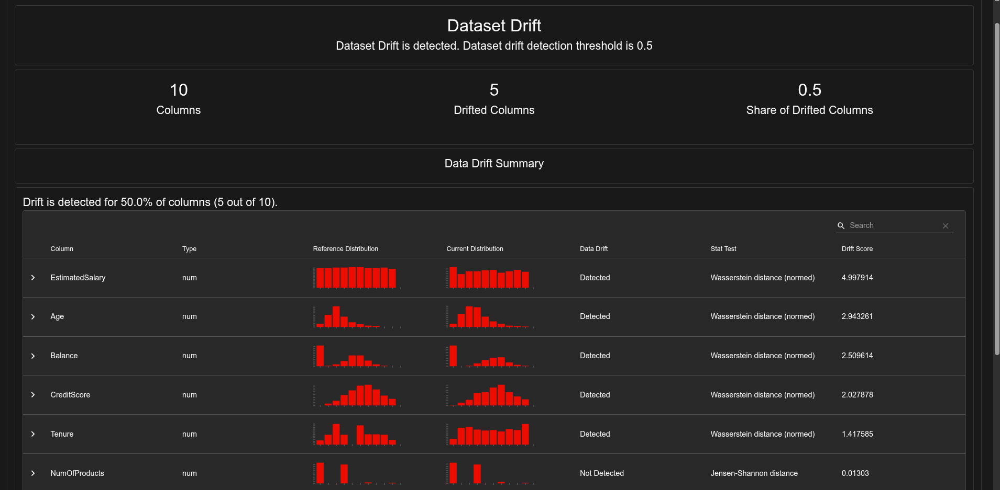
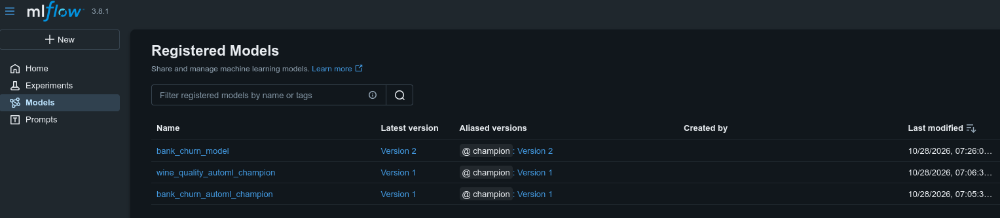
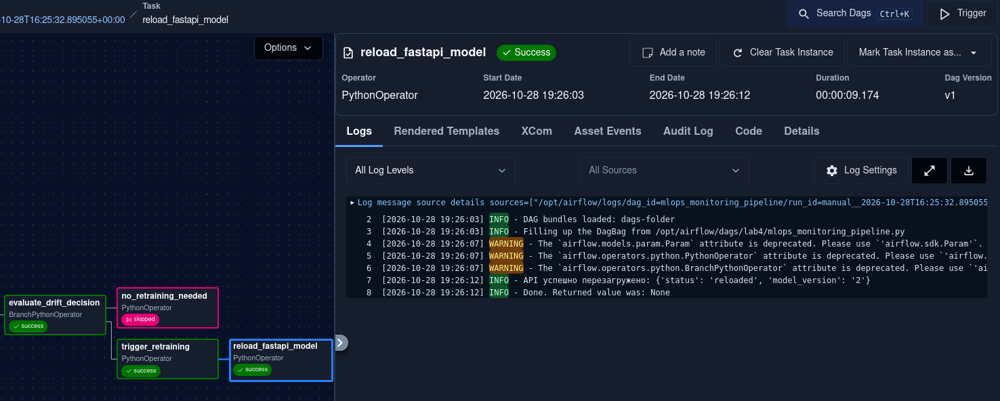
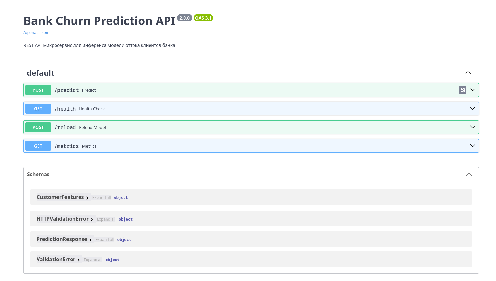
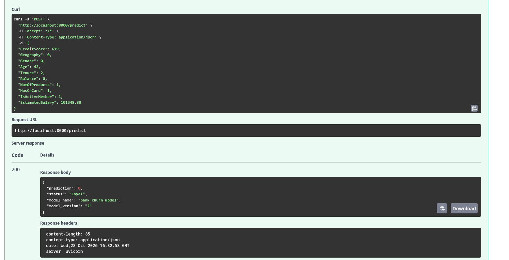
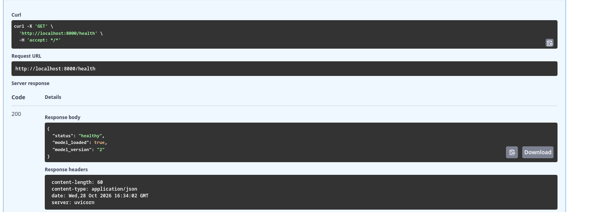
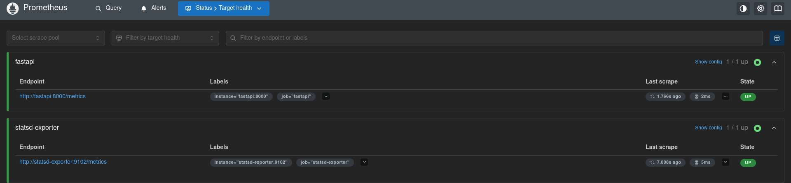
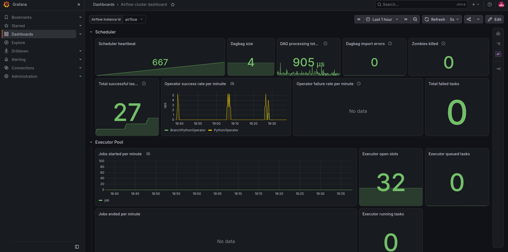

# Отчет по лабораторной работе №4
## Дисциплина: «Автоматизация машинного обучения»
### Тема: Полный MLOps-пайплайн с развертыванием сервиса, мониторингом дрейфа и автопереобучением (End-to-End)

**Вариант:** №6 — Прогнозирование оттока клиентов банка (`Bank Customer Churn`)

---

## 1. Цель работы
Спроектировать и развернуть замкнутый промышленный конвейер машинного обучения (End-to-End MLOps Pipeline). Реализовать REST API микросервис инференса на базе FastAPI, интегрировать экспорт системных метрик в Prometheus и Grafana, внедрить статистический мониторинг дрейфа данных с помощью Evidently AI и настроить условное автоматическое переобучение (Continuous Training) в Apache Airflow с бесшовной перезагрузкой модели в памяти API без остановки сервиса.

---

## 2. Архитектура сквозного решения
1. **Сервис инференса (`lab4/api/main.py`):**
   * Развернут в отдельном контейнере `fastapi` на порту `:8000`.
   * При старте через контекстный менеджер `lifespan` загружает актуальную модель из MLflow Model Registry по алиасу `models:/bank_churn_model@champion`.
   * Предоставляет эндпоинты: `POST /predict` (предсказание оттока с валидацией через Pydantic V2), `GET /health` (статус сервиса и версия модели), `POST /reload` (горячая перезагрузка весов модели по сигналу из Airflow) и `GET /metrics` (метрики для Prometheus).
2. **Детекция дрейфа данных (`lab4/scripts/data_drift_detector.py`):**
   * Модуль `DataDriftMonitor` на базе **Evidently AI (`0.7+`)** сопоставляет эталонную обучающую выборку (`Reference`) с новым входящим батчем (`Current`).
   * Генерирует интерактивный HTML-отчет `data_drift_report.html` и вычисляет долю смещенных признаков (`share_of_drifted_columns`).
3. **Условное переобучение и деплой (`lab4/dags/mlops_monitoring_pipeline.py`):**
   * Оператор ветвления `BranchPythonOperator` (`evaluate_drift_decision`) проверяет наличие дрейфа.
   * **При наличии дрейфа:** запускается задача `trigger_retraining` (обучение новой модели, перенос алиаса `@champion` на новую версию в MLflow) и задача `reload_fastapi_model` (отправка HTTP POST запроса на `http://fastapi:8000/reload`).
   * **При отсутствии дрейфа:** выполняется ветка `no_retraining_needed`, экономящая вычислительные ресурсы.

---

## 3. Результаты выполнения и иллюстрации

### 3.1. Граф Airflow: Сценарий обнаружения дрейфа и автопереобучения
При запуске пайплайна с параметром `simulate_drift = True` система зафиксировала статистический сдвиг признаков, пропустила ветку `no_retraining_needed` (`skipped`) и успешно выполнила цепочку `trigger_retraining` ➔ `reload_fastapi_model` (`success`).

  
*Рисунок 1 — Выполнение пайплайна при обнаружении дрейфа: активация переобучения и перезагрузки API.*

### 3.2. Граф Airflow: Сценарий стабильных данных (пропуск переобучения)
При подаче стабильного батча данных (`simulate_drift = False`) оператор ветвления направил выполнение по ветке `no_retraining_needed` (`success`), а ресурсоемкие задачи переобучения были пропущены (`skipped`).

  
*Рисунок 2 — Выполнение пайплайна при отсутствии дрейфа: пропуск переобучения.*

### 3.3. Отчет детекции дрейфа данных Evidently AI в MLflow
В эксперименте `lab4_monitoring_and_drift` сохранен артефакт `data_drift_report.html`, наглядно отображающий гистограммы сдвига распределений признаков (`Age`, `Balance`, `EstimatedSalary`, `CreditScore`).

  
*Рисунок 3 — Интерактивный дашборд Evidently AI с анализом смещения распределений признаков.*

### 3.4. Автоматическое обновление версии модели в MLflow Model Registry
После выполнения задачи `trigger_retraining` в реестре моделей зарегистрирована новая версия модели `bank_churn_model`, которой автоматически передан алиас `@champion`.

  
*Рисунок 4 — Переход алиаса `@champion` к новой дообученной версии модели в реестре MLflow.*

### 3.5. Логи горячей перезагрузки API по Webhook из Airflow
В логах задачи `reload_fastapi_model` видно успешное обращение к эндпоинту `http://fastapi:8000/reload` и ответ сервиса о загрузке новой версии модели в оперативную память.

  
*Рисунок 5 — Логи успешного выполнения Webhook-запроса горячей перезагрузки модели.*

### 3.6. Интерактивная документация микросервиса FastAPI (Swagger UI)
Веб-интерфейс Swagger UI на `http://localhost:8000/docs` отображает все доступные эндпоинты микросервиса (`/predict`, `/health`, `/reload`, `/metrics`) и схемы данных Pydantic.

  
*Рисунок 6 — Документация REST API микросервиса инференса в Swagger UI.*

### 3.7. Тестирование предсказания через эндпоинт `POST /predict`
Выполнен тестовый запрос с признаками клиента банка. Сервис вернул корректный JSON-ответ с предсказанным классом, текстовым статусом и номером активной версии модели.

  
*Рисунок 7 — Результат выполнения предсказания через эндпоинт `/predict`.*

### 3.8. Проверка состояния сервиса через `GET /health`
Эндпоинт `/health` подтверждает статус `healthy`, флаг `model_loaded: true` и актуальную версию модели в памяти.

  
*Рисунок 8 — Ответ эндпоинта `/health` с информацией о загруженной версии модели.*

### 3.9. Мониторинг таргетов и метрик инференса в Prometheus
В интерфейсе Prometheus (`http://localhost:9090`) таргет `fastapi:8000` находится в состоянии `UP`, собираются метрики количества запросов `model_predictions_total` и задержки `model_prediction_latency_seconds`.

  
*Рисунок 9 — Сбор метрик микросервиса инференса в Prometheus.*

### 3.10. Дашборд мониторинга кластера в Grafana
В Grafana (`http://localhost:3000`) отображаются показатели работы оркестратора Airflow, пула воркеров и времени выполнения задач в реальном времени.

  
*Рисунок 10 — Панель мониторинга состояния системы в Grafana.*

---

## 4. Вывод
В ходе выполнения лабораторной работы №4 построен полноценный промышленный MLOps-пайплайн замкнутого цикла. Реализована подача модели через высокопроизводительный сервис FastAPI, настроен автоматический контроль дрейфа входных данных с помощью Evidently AI, внедрено условное переобучение в Airflow с бесшовным обновлением модели в памяти сервиса без даунтайма, а также развернут стек системного мониторинга Prometheus + Grafana.